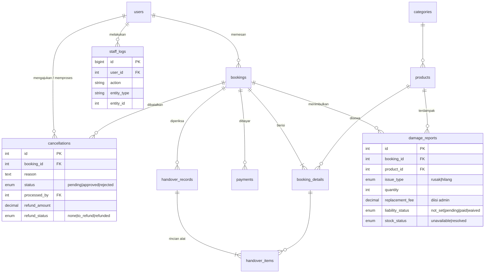

# CampRent: Modul Nabila (Anggota 4)
**Dashboard Staff/Admin, Laporan, dan Kondisi Alat**
Tenggat hari ini: 7 November 2026 (database, ERD, alur sistem disepakati)

---

## 1. ERD (bagian yang berhubungan dengan modul Nabila)



File SQL lengkap: `camprent_schema_nabila.sql` (Bagian A = milik Nabila, Bagian B = usulan tabel anggota lain).

---

## 2. Keputusan desain yang perlu dikonfirmasi tim

| # | Keputusan | Usulan | Dengan siapa |
|---|-----------|--------|--------------|
| 1 | Status booking | `pending, confirmed, picked_up, completed, cancelled` | Aul |
| 2 | Status pembatalan | `pending, approved, rejected` | Aul |
| 3 | Stok dilepas saat batal | **Tidak ada update stok.** Ketersediaan selalu dihitung dari booking yang statusnya bukan `cancelled`, jadi begitu booking jadi `cancelled`, stok otomatis bebas | Aul, Afifah |
| 4 | Stok rusak/hilang | Tabel `damage_reports` (`stock_status = unavailable`) dikurangkan dari stok layak sewa lewat view `v_product_unavailable` | Aul, Afifah |
| 5 | Role di tabel `users` | Kolom `role ENUM('user','staff','admin')`, plus `is_active` | Hasna |
| 6 | Siapa menetapkan biaya ganti rugi | Staff melapor, **admin** menetapkan `replacement_fee` (sesuai alur di dokumen) | Seluruh tim / dosen |
| 7 | Pengunjung tanpa akun boleh booking? | `bookings.user_id` boleh NULL | Aul, Hasna |
| 8 | Tabel tambahan `handover_items` | Dibutuhkan agar satu booking bisa mencatat sebagian alat baik dan sebagian rusak | Aul |

Rumus stok layak sewa (untuk Aul):

```
stok_layak_sewa = products.stock_total
                  - COALESCE(v_product_unavailable.qty_unavailable, 0)
                  - SUM(booking_details.quantity)   -- booking tumpang tindih, status != 'cancelled'
```

---

## 3. Alur yang jadi tanggung jawab Nabila

**Pembatalan:** Aul membuat baris `cancellations` berstatus `pending`. Staff melihat daftar (`v_pending_cancellations`), lalu:
- **Reject:** `cancellations.status = rejected`, booking tidak berubah.
- **Approve:** `cancellations.status = approved`, `bookings.status = cancelled`, simpan `refund_amount` dan `refund_status`, tulis `staff_logs`.

**Pengembalian alat:** staff membuat `handover_records` (type `return`) dan `handover_items`.
- Semua baik: booking menjadi `completed`.
- Ada yang rusak/hilang: buat `damage_reports` (`unavailable`, `not_set`), lalu admin menetapkan biaya (`pending`), dan jika sudah diganti atau stok pulih ubah menjadi `paid`/`waived` serta `stock_status = resolved`.

---

## 4. Query siap pakai untuk dashboard (jadwal 8-22 Nov)

```sql
-- Sewa aktif hari ini
SELECT COUNT(*) FROM bookings
WHERE CURDATE() BETWEEN start_date AND end_date
  AND status IN ('confirmed','picked_up');

-- Pembatalan menunggu
SELECT COUNT(*) FROM cancellations WHERE status = 'pending';

-- Pendapatan (dummy) dari pembayaran lunas
SELECT COALESCE(SUM(amount),0) FROM payments WHERE status = 'paid';

-- Tabel transaksi terbaru
SELECT booking_code, contact_name, start_date, end_date, total_price, status
FROM bookings ORDER BY created_at DESC LIMIT 20;

-- Grafik penyewaan per bulan
SELECT DATE_FORMAT(created_at, '%Y-%m') AS periode, COUNT(*) AS jumlah
FROM bookings WHERE status <> 'cancelled'
GROUP BY periode ORDER BY periode;

-- Jumlah pembatalan per bulan
SELECT DATE_FORMAT(requested_at, '%Y-%m') AS periode,
       SUM(status = 'approved') AS disetujui,
       SUM(status = 'rejected') AS ditolak
FROM cancellations GROUP BY periode ORDER BY periode;

-- Pemakaian stok hari ini (persen per produk)
SELECT p.name, p.stock_total,
       COALESCE(SUM(bd.quantity),0) AS dipakai,
       ROUND(COALESCE(SUM(bd.quantity),0) / p.stock_total * 100) AS persen
FROM products p
LEFT JOIN booking_details bd ON bd.product_id = p.id
LEFT JOIN bookings b ON b.id = bd.booking_id
     AND b.status IN ('confirmed','picked_up')
     AND CURDATE() BETWEEN b.start_date AND b.end_date
GROUP BY p.id;
```

Contoh approve pembatalan (PHP, PDO, atomik):

```php
$pdo->beginTransaction();
try {
    // 1. kunci baris pembatalan, pastikan masih pending
    $c = $pdo->prepare("SELECT booking_id FROM cancellations
                        WHERE id = ? AND status = 'pending' FOR UPDATE");
    $c->execute([$cancellationId]);
    $row = $c->fetch(PDO::FETCH_ASSOC);
    if (!$row) throw new RuntimeException('Pengajuan tidak ditemukan / sudah diproses');

    // 2. update pembatalan
    $pdo->prepare("UPDATE cancellations
                   SET status='approved', processed_by=?, processed_at=NOW(),
                       staff_note=?, refund_amount=?, refund_status=?
                   WHERE id=?")
        ->execute([$_SESSION['user_id'], $note, $refund, $refundStatus, $cancellationId]);

    // 3. booking jadi cancelled (stok otomatis lepas karena dihitung dari status)
    $pdo->prepare("UPDATE bookings SET status='cancelled' WHERE id=?")
        ->execute([$row['booking_id']]);

    // 4. audit log
    $pdo->prepare("INSERT INTO staff_logs (user_id, action, entity_type, entity_id, description, ip_address)
                   VALUES (?, 'cancellation.approve', 'booking', ?, ?, ?)")
        ->execute([$_SESSION['user_id'], $row['booking_id'], $note, $_SERVER['REMOTE_ADDR']]);

    $pdo->commit();
} catch (Throwable $e) {
    $pdo->rollBack();
    throw $e;
}
```

Aturan keamanan di semua halaman `staff/` dan `admin/`: cek login, cek role (`staff` atau `admin`; halaman akun/audit log hanya `admin`), pakai prepared statement, dan `htmlspecialchars()` untuk output.

---

## 5. Rencana kerja Nabila (sesuai timeline)

| Tanggal | Target |
|---------|--------|
| **5-7 Nov** (hari ini) | Skema DB + ERD + keputusan di bagian 2 disepakati tim |
| 8-12 Nov | Dashboard staff, ringkasan transaksi, daftar penyewaan |
| 13-18 Nov | Approve/reject pembatalan, ubah status booking, catatan refund/deposit |
| 19-22 Nov | Dashboard admin, manajemen akun, audit log, grafik, kerusakan/kehilangan |
| 23-25 Nov | Integrasi dengan booking Aul, uji sinkronisasi status dan stok |
| 26-28 Nov | Uji hak akses, pembatalan, laporan, kondisi alat |
| 29-30 Nov | Finalisasi dan dokumentasi modul |

## 6. Pesan koordinasi (tinggal kirim ke grup)

> Halo semua, ini skema database bagian Nabila (`camprent_schema_nabila.sql`). Mohon dicek hari ini ya:
> - **Hasna:** tabel `users` pakai kolom `role` (user/staff/admin) dan `is_active`, oke?
> - **Aul:** status booking `pending/confirmed/picked_up/completed/cancelled` dan status pembatalan `pending/approved/rejected`, oke? Stok dihitung dari booking non-cancelled, jadi tidak ada update stok saat batal.
> - **Aul + Afifah:** stok layak sewa = `stock_total` dikurangi `v_product_unavailable` dikurangi booking bertumpuk.
> - Kalau ada kolom yang mau diubah, kabari aku sebelum malam ini ya.
